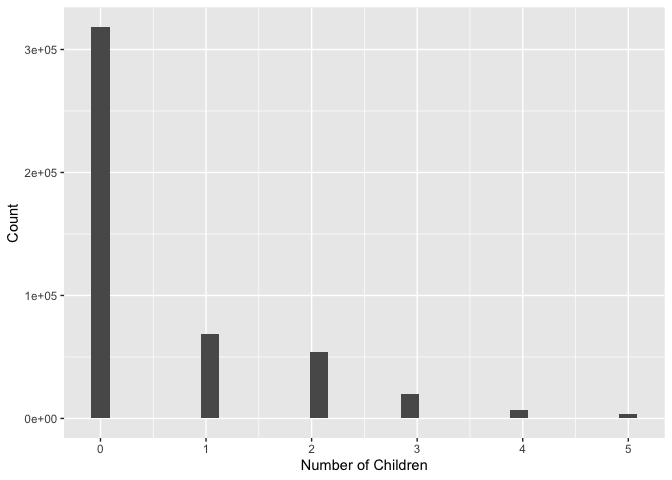
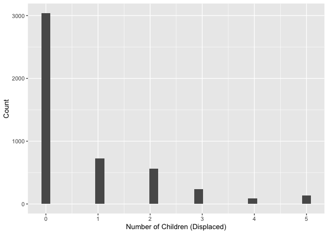

# Geog4/6300: Lab 4


- [<span class="toc-section-number">1</span> One and two sample
  difference tests](#one-and-two-sample-difference-tests)
- [<span class="toc-section-number">2</span> Assessment
  criteria](#assessment-criteria)
  - [<span class="toc-section-number">2.1</span> Loading/filtering data
    and checking for
    normality.](#loadingfiltering-data-and-checking-for-normality)
  - [<span class="toc-section-number">2.2</span> Testing the difference
    in number of
    children.](#testing-the-difference-in-number-of-children)
  - [<span class="toc-section-number">2.3</span> Identifying differences
    in time displaced by natural disasters across income
    groups](#identifying-differences-in-time-displaced-by-natural-disasters-across-income-groups)
  - [<span class="toc-section-number">2.4</span> Challenge
    Question:](#challenge-question)
  - [<span class="toc-section-number">2.5</span> Final submission
    stuff](#final-submission-stuff)

## One and two sample difference tests

**Overview:** In this lab, you’ll be doing analysis with public use
microdata from the Household Pulse survey administered by the U.S.
Census Bureau during the COVID pandemic. The survey had a particular
focus on pandemic effects on health and wellbeing, but it also included
questions on the impact of natural disasters on households. That’s the
section you’ll be focusing on here.

Unlike the aggregate census data you’re probably used to working with,
microdata provide anonymized individual-level responses that researchers
can use to calculate their own summary statistics and estimates.

There’s more info on the Pulse survey and the public use microdata file
at this link:

- [Household Pulse Survey Public Use
  Files](https://www.census.gov/programs-surveys/household-pulse-survey/data/datasets.html)

The main data are contained in the `pulse_2023` csv file in the data
folder. The data dictionary for this dataset is also available in the
data folder.

You’ll use this data to answer two research questions:

- Did households displaced by natural disasters include more children
  than those not displaced?
- Is there a relationship between household income and a household’s
  ability to return to its place of residence after being displaced?

## Assessment criteria

This lab assesses the following learning standards:

21. Assess the normality of a variable and use those results to select
    between parametric and non-parametric statistical tests.
22. Apply two-sample tests of difference and accurately interpret
    results in terms of hypothesis testing, statistical significance,
    and the direction and magnitude of any differences.
23. Construct contingency tables and apply chi-square tests to assess
    association between categorical variables, interpreting results in
    terms of significance and practical meaning.

### Loading/filtering data and checking for normality.

In the first part of the lab, you’ll be using two variables:
THHLD_NUMKID (number of children in a household) and ND_DISPLACE
(whether a household was displaced by a natural disaster in the last
year).

Load the dataset using read_csv, and also take a look at the two
variables of interest in the data dictionary. For this lab, you only
want observations with valid responses, filtering out records where
respondents did not provide an answer. Filter these data so you have
only valid responses.

**Task 1** *Load the Pulse data and filter it to only valid responses.*

``` r
household_data <- read_csv("data/pulse_2023.csv")
```

    Rows: 539305 Columns: 48
    ── Column specification ────────────────────────────────────────────────────────
    Delimiter: ","
    chr  (2): SCRAM, EST_ST
    dbl (46): WEEK, EST_MSA, REGION, HWEIGHT, PWEIGHT, TBIRTH_YEAR, ABIRTH_YEAR,...

    ℹ Use `spec()` to retrieve the full column specification for this data.
    ℹ Specify the column types or set `show_col_types = FALSE` to quiet this message.

``` r
household_data_filtered <- household_data %>%
  select("THHLD_NUMKID","ND_DISPLACE") %>%
  filter(ND_DISPLACE != -88, ND_DISPLACE != -99)
```

You’ll be conducting a two-sample test of difference to look at whether
the number of children differs between those displaced and not
displaced. To know which test to use, you have to assess the normality
of the THHLD_NUMKID variable.

**Task 2** *Assess the normality of this variable using either a
histogram OR a qq line. Make sure your plot is visible and interpret
what it shows you about the normality of this variable.*

``` r
#Attempted a Shapiro test (out of curiosity; found that the sample size is far too large). Now attempting a QQ line. 

#Including a QQ Plot for reference; however, I thought the histogram looked a bit more clear
#ggplot(household_data_filtered,aes(sample=THHLD_NUMKID)) +
  #stat_qq() +
  #stat_qq_line()

ggplot(household_data_filtered,aes(x=THHLD_NUMKID)) + 
  geom_histogram() +
  labs(x = "Number of Children",
       y = "Count")
```

    `stat_bin()` using `bins = 30`. Pick better value `binwidth`.



*Interpretation of Task 2*: Based on the histogram provided above (and a
QQ plot created above – but commented out for simplicity), this data is
certainly not normally distributed. Instead, this data is exceptionally
right-skewed, with the majority (67.5% of the observations, according to
the R “summary” feature) of the individuals reporting they have no
children. As such, I will have to proceed with a test that does not rely
on normally distributed data.

### Testing the difference in number of children.

Now you can test whether the number of children differs between
displaced and non-displaced households.

**Task 3** *Based on the normality of the data, what is the appropriate
statistical test for determining whether the number of children differs
between these two groups? Explain why this test is appropriate and give
a null and alternative hypothesis for this test*

It appears that the Wilcoxon rank-sum test is the most appropriate here,
as it can be used for non-parametric data (which certainly is the case
here) and is most appropriate when the independent variable is binary in
nature (in this case, a 1 or 2 for if a family was displacd or not) and
the dependent variable is quantitative (which is also certainly the case
here, given the number of children is a ratio quantity).

To determine whether the number of children differs between the two
independent variable groups (either displaced or not), I would define
the following null and alternative hypotheses:

Null Hypothesis: The number of children in households that have been
displaced by natural disasters is the same as the number of children in
non-displaced households. In other words, there is no statistically
significant difference in number of children between the two groups.  
Alternative Hypothesis: The number of children in households that have
been displaced by natural disaster is *not* the same as the number of
children in households that have not been displaced. In other words,
there is a statistically significant difference in number of children
between the two groups.

**Task 4** *Run the test you identified in Task 3. Also calculate the
mean for each dataset, which you can use to determine the nature of the
difference–which group (if any) has more children.*

``` r
num_kids <- c(household_data_filtered$THHLD_NUMKID) #Made these two vectors for the number of children and displaced variables, as that seemed to be an easier way to insert those values into the Wilcoxon test below
displaced <- c(household_data_filtered$ND_DISPLACE)

test_task4 <- wilcox.test(num_kids~displaced)
test_task4
```


        Wilcoxon rank sum test with continuity correction

    data:  num_kids by displaced
    W = 1171425061, p-value = 2.463e-12
    alternative hypothesis: true location shift is not equal to 0

``` r
mean_kids_displaced <- household_data_filtered %>%
  filter(ND_DISPLACE == 1)
mean(mean_kids_displaced$THHLD_NUMKID)
```

    [1] 0.7472826

``` r
mean_kids_not_displaced <- household_data_filtered %>%
  filter(ND_DISPLACE == 2)
mean(mean_kids_not_displaced$THHLD_NUMKID)
```

    [1] 0.5944313

``` r
#Plotting the distribution of both the displaced and non-displaced datasets demonstrates they have a very similar shape, indicating this test should be useful. 
ggplot(mean_kids_displaced,aes(x=THHLD_NUMKID)) + 
  geom_histogram() +
  labs(x = "Number of Children (Displaced)",
       y = "Count")
```

    `stat_bin()` using `bins = 30`. Pick better value `binwidth`.



**Task 5** *Interpret the results of the analysis you did in task 4.* \*
Do you reject the null hypothesis? Why or why not? \* Based on the test
result and the group means, what can we conclude about differences in
the number of children between these two groups?

Task 5 Response: Based on the test performed above, I do reject the null
hypothesis that there is no difference between the number of kids per
household betweeen the displaced and non-displaced groups. I come to
this conclusion because the Wilcoxon rank-sum test performed above
yielded an extremely small p-value (much less than 0.05, if we were
looking for 95% confidence). The interpretation for the W value seems
less clear, the very large number returned for that value also lends
confidence to the idea that there is a staistiaclly singificant
difference between these two groups.

In terms of magnitude and direction, it appears that the number of
children per household tends to be higher for families that have been
displaced than those that have not, with the displaced group averaging
0.75 children (indicative of a higher overall distribution, given that
you cannot have a 3/4th child) and the non-displaced group averaging
0.59 children per household (again, indicative of a lower overall
distribution, not the presence of half-children). Although this
difference does not appear large, it certainly is not neglibile
(especially given that it is statistically significant) given that the
highest number of children recorded in the dataset is only 5.

Together, this indicates that there is a statistically significant
difference in nummber of kids between households that have been
displaced by natural disasters and those that have not (based on the
Pulse survey data used herein). On average, households that had been
displaced had more children than those that had not, with the difference
being somewhat small, but certainly not negligible.

### Identifying differences in time displaced by natural disasters across income groups

In Part 2, you used a test of difference that included a continuous and
categorical variable. In this section, you’ll focus only on households
displaced by natural disasters to identify statistically significant
differences in time displaced using two categorical variables: one
placing responses into groups by income (INCOME) and the other showing
the time displaced (ND_HOWLONG).

Again, look at the data dictionary to better understand how these two
variables are structured.

**Task 6** *Reload the original, unfiltered Pulse dataset (not the one
you used in parts 1 and 2). Select only observations for households
displaced by a natural disaster using the ND_DISPLACE variable. Then
filter for records with valid responses to INCOME and ND_HOWLONG. Call
the head of the table with `kable` when done.*

``` r
household_data_part2 <- read_csv("data/pulse_2023.csv") %>%
  filter(ND_DISPLACE == 1) %>%
  filter(INCOME != -88, INCOME != -99, ND_HOWLONG != -88, ND_HOWLONG != -99)
```

    Rows: 539305 Columns: 48
    ── Column specification ────────────────────────────────────────────────────────
    Delimiter: ","
    chr  (2): SCRAM, EST_ST
    dbl (46): WEEK, EST_MSA, REGION, HWEIGHT, PWEIGHT, TBIRTH_YEAR, ABIRTH_YEAR,...

    ℹ Use `spec()` to retrieve the full column specification for this data.
    ℹ Specify the column types or set `show_col_types = FALSE` to quiet this message.

``` r
kable(head(household_data_part2))
```

| SCRAM | WEEK | EST_ST | EST_MSA | REGION | HWEIGHT | PWEIGHT | TBIRTH_YEAR | ABIRTH_YEAR | RHISPANIC | AHISPANIC | RRACE | ARACE | EEDUC | AEDUC | MS | EGENID_BIRTH | AGENID_BIRTH | GENID_DESCRIBE | SEXUAL_ORIENTATION | THHLD_NUMPER | AHHLD_NUMPER | THHLD_NUMKID | AHHLD_NUMKID | THHLD_NUMADLT | KIDS_LT5Y | KIDS_5_11Y | KIDS_12_17Y | INCOME | ND_DISPLACE | ND_TYPE1 | ND_TYPE2 | ND_TYPE3 | ND_TYPE4 | ND_TYPE5 | ND_HOWLONG | ND_DAMAGE | ND_FDSHRTAGE | ND_WATER | ND_ELCTRC | ND_UNSANITARY | ND_ISOLATE | ND_CRIME | ND_SCAM | MEDICAID | MEDICAID_NO | FDBENEFIT3 | LIVQTRRV |
|:---|---:|:---|---:|---:|---:|---:|---:|---:|---:|---:|---:|---:|---:|---:|---:|---:|---:|---:|---:|---:|---:|---:|---:|---:|---:|---:|---:|---:|---:|---:|---:|---:|---:|---:|---:|---:|---:|---:|---:|---:|---:|---:|---:|---:|---:|---:|---:|
| V560000089 | 56 | 21 | NA | 2 | 1607.2081 | 3016.3389 | 1987 | 2 | 1 | 2 | 1 | 2 | 7 | 2 | 1 | 1 | 2 | 1 | 2 | 2 | 2 | 0 | 2 | 2 | -88 | -88 | -88 | 3 | 1 | -99 | -99 | -99 | -99 | 1 | 1 | 2 | 1 | 1 | 3 | 1 | 1 | 1 | 1 | 3 | -88 | 1 | 2 |
| V560000117 | 56 | 42 | NA | 1 | 3166.8361 | 8755.5654 | 1953 | 2 | 1 | 2 | 1 | 2 | 4 | 2 | 1 | 1 | 2 | 1 | 2 | 3 | 2 | 0 | 2 | 3 | -88 | -88 | -88 | 4 | 1 | -99 | -99 | -99 | -99 | 1 | 1 | 3 | 2 | 1 | 4 | 1 | 3 | 3 | 4 | 3 | -88 | 1 | 1 |
| V560000205 | 56 | 21 | NA | 2 | 828.5883 | 3110.1176 | 1954 | 2 | 1 | 2 | 1 | 2 | 6 | 2 | 5 | 2 | 2 | 2 | 2 | 4 | 2 | 0 | 2 | 4 | -88 | -88 | -88 | 4 | 1 | -99 | 1 | -99 | -99 | -99 | 5 | 4 | 1 | 1 | 4 | 3 | 4 | 1 | 3 | 3 | -88 | 1 | 2 |
| V560000506 | 56 | 26 | 19820 | 3 | 1024.8124 | 950.5055 | 1964 | 2 | 1 | 2 | 1 | 2 | 6 | 2 | 5 | 1 | 2 | 1 | 2 | 1 | 2 | 0 | 2 | 1 | -88 | -88 | -88 | 6 | 1 | -99 | -99 | -99 | -99 | 1 | 1 | 2 | 1 | 1 | 3 | 1 | 2 | 1 | 1 | 3 | -88 | 1 | 2 |
| V560000603 | 56 | 45 | NA | 2 | 1084.5817 | 2045.7398 | 1971 | 2 | 1 | 2 | 1 | 2 | 6 | 2 | 1 | 1 | 2 | 1 | 2 | 2 | 2 | 0 | 2 | 2 | -88 | -88 | -88 | 8 | 1 | 1 | -99 | -99 | -99 | -99 | 1 | 1 | 1 | 1 | 2 | 1 | 1 | 1 | 4 | 3 | -88 | 1 | 2 |
| V560000686 | 56 | 37 | NA | 2 | 650.4371 | 636.1618 | 1969 | 2 | 1 | 2 | 1 | 2 | 5 | 2 | 3 | 2 | 2 | 2 | 2 | 2 | 2 | 1 | 2 | 1 | -99 | -99 | 1 | 1 | 1 | -99 | -99 | -99 | 1 | -99 | 5 | 4 | 3 | 1 | 2 | 1 | 1 | 1 | 1 | -88 | -88 | 1 | 3 |

**Task 7** *Create a contingency table of responses to the ND_HOWLONG
variable by INCOME. The rows of this table should be the income groups
and the columns should be the categorical variables showing time
displaced. Call the table when you are done.*

``` r
con_table_long_income <- household_data_part2 %>%
  count(ND_HOWLONG, INCOME, name = "count") %>%
  pivot_wider(names_from= ND_HOWLONG, values_from=count)

kable(con_table_long_income)
```

| INCOME |   1 |   2 |   3 |   4 |   5 |
|-------:|----:|----:|----:|----:|----:|
|      1 | 286 | 218 | 115 |  69 | 179 |
|      2 | 162 | 122 |  50 |  23 |  63 |
|      3 | 221 | 135 |  67 |  32 |  50 |
|      4 | 316 | 160 |  78 |  42 |  52 |
|      5 | 219 | 107 |  54 |  23 |  33 |
|      6 | 317 | 115 |  58 |  37 |  37 |
|      7 | 142 |  54 |  22 |   8 |  11 |
|      8 | 223 |  64 |  45 |  35 |  43 |

**Task 8** *Run a chi-square test on your contingency table to assess
whether there are statistically significant differences in displacement
time between these income groups. You’ll likely need to delete the
INCOME variable to do so.*

``` r
chisq_test_task8 <- chisq.test(con_table_long_income %>% select(-INCOME))
chisq_test_task8
```


        Pearson's Chi-squared test

    data:  con_table_long_income %>% select(-INCOME)
    X-squared = 210.51, df = 28, p-value < 2.2e-16

**Task 9** *To help with your interpretation of results, Calculate the
percentage of households within each income group that fall into
category 1 of ND_HOWLONG (“displaced less than a week”).*

``` r
con_table_long_income_pct <- con_table_long_income %>%
    pivot_longer(`1`:`5`,
                 names_to= "Income",
                 values_to= "count") %>%
    mutate(total= sum(count)) %>%
    mutate(pct = round(count/sum(count)*100, 2)) %>%
    select(-count,-total) %>%
    pivot_wider(names_from= Income,
                values_from= pct)

con_table_long_income_pct_cat1 <- con_table_long_income %>%
  select(2) %>%
  mutate(total = sum(`1`)) %>%
  mutate(pct = round(`1`/sum(`1`)*100, 2)) %>%
  select(-total)

kable(con_table_long_income_pct_cat1)
```

|   1 |   pct |
|----:|------:|
| 286 | 15.16 |
| 162 |  8.59 |
| 221 | 11.72 |
| 316 | 16.76 |
| 219 | 11.61 |
| 317 | 16.81 |
| 142 |  7.53 |
| 223 | 11.82 |

**Task 10** *Interpret the results of your analysis in tasks 8 and 9.*
\* Do you reject the null hypothesis based on these results and why (or
why not)? \* What do your results in Task 9 tell you about differences
in how quickly households were able to return?

Task 10 Response: In this case, I do reject the null hypothesis that
there is no statistically significant relationship between a family’s
time of displacement and their income group. In this case, this is
strongly supported by a very small p-value (much less than 0.05) and a
very large chi-squared statistic (210.51, much larger than the 41.337
needed for significance at 95% confidence at df = 28). As such, it
appears clear that there is a relationship between the time it takes for
a family to return home and their income.

In terms of magnitude and direction, it appears (as expected) that those
in lower income groups tended to have a harder time getting back in
their homes in a timely manner. This is supported by the percentages
displayed in the kable() from Task 9, and also in the general table of
probabilities (as demonstrated in the `con_table_long_income_pct`
table). In both cases, there are higher proportions of individuals in
the “1” (less than \$25,000 a year) income group than there are in any
other income group. This trend also generally holds for the other
lower-income grups (i.e., 2-4), as each of those groups have higher
proportions of people that took longer to return to their home than
income groups 5-7. Income group 8 was a slight departure for this trend,
as it had a somewhat larger proportion of people that took longer than 6
months to return to their homes (or never returned at all); howwever,
this might be explainable solely because these families can afford to be
displaced for longer and thus did not feel a time pressure to return to
their homes. In any case, it appears that there is an obvious
relationship between income and time it takes to return home, with those
that lack income-related resources typically having a harder time
getting back in their homes faster. This (as noted above) is not
entirely unexpected, as these families might have a harder time
gathering resources to begin home repairs, and thus would likely be
dependent on FEMA or other funds to begin that process (especially given
they would be using their already-low income to find housing and other
necessities while they are displaced).

### Challenge Question:

Calculate and map the percentage of households reporting displacement
(ND_DISPLACE) by state. To do so, you’ll need to start with a version of
the dataset that excludes non-valid responses and then calculate the
percentage displaced by state.

Once you’ve calculated that estimate, map it out using the
`states_albers` geopackage file in the data folder. Provide a brief
description of the patterns you observe.

``` r
#Code goes here
```

### Final submission stuff

**Disclosure of assistance:** Besides class materials, what other
sources of assistance did you use while completing this lab? These can
include input from classmates, relevant material identified through web
searches (e.g., Stack Overflow), or assistance from ChatGPT or other AI
tools. How did these sources support your own learning in completing
this lab?

The primary resources I utilized in completing this assignment (beyond
class materials like in-class scripts) were my classmates (especially
Will, per usual), limited use of AI, and the use of a comprehensive list
of statistical tests (linked below) from Stats Tutor to determine which
test to use for Part 1 of this lab. In terms of classmate help, I
primarily collaborted with Will to ensure my answer to Task 4 was
correct – as I had originally had made some mistakes on that question.
Specifically, Will helped me realize that I needed to use the “~” syntax
within the Wilcoxon test because the typical “,” only tests if there are
differences in the values of each column (which there obviously was,
given that one variable \[“ND_DISPLACE”\]) was simply a binary (1,2)
variable while the other \[“THHLD_NUMKID”\] was ratio data) –
information which is not valuable because there was a known difference
in these values. Instead, Will indicated that I needed to use the “~”
syntax to have the Wilcoxon test more correctly evaluate if there was a
meaningful difference in the number of kids values for displaced or
non-displaced (again, 1 or 2 for “ND_DISPLACE”) groups, rather than just
if the values themselves were different on a row-by-row basis (again,
was the case for the “,” syntax).

Beyond that, I also used AI (primarily ChatGPT) in a limited way in this
lab to troubleshoot issues I was not able to effectively fix. The most
notable of these was on Task 9, where I needed AI’s help to realize that
I was getting in an error when creating my first percentage contigency
table becaus I was trying to use “INCOME” as my names_to variable (which
already existed in the origin dataframe). Although simple, this
realization helped me to recognize that I could not re-use variable
names from the original dataframe to any new dataframe I attempted to
create – a small (but important) skill I can now carry forward to future
work. Beyond that, I was mostly able to limit my use of AI in completing
the work presented above.

Finally, as noted above, I also utilized a comprehensive list of
statistical tests from Stats Tutor (linked below) to help me understand
and choose a test to use in Part 1 of this lab. Not only did this source
help me make that choice, but it also helped me gain additional insight
into the vast array of statistical tests at our disposal. I would
certainly need to continue to study this source – and our in-class
discussion – to deepen that insight; however, this source certainly was
helpful in pushing my understanding of these various statistical tests
in the right direction.

Statistical Test Source Link:
https://www.statstutor.ac.uk/resources/uploaded/tutorsquickguidetostatistics.pdf

**Lab reflection:** How do you feel about the work you did on this lab?
Was it easy, moderate, or hard? What are the biggest things you learned
by completing it?

I found the work for this lab somewhere between easy and moderate. Given
that we had discussed the two tests performed above in class, crafting
the code to perform those tests was relatively easy (aside from the
above-mentioned need to learn the “~” syntax for the Wilcoxon test).
Visualizing that data in plots and tables was also relatively easy,
given that we have practiced that skill extensively thus far in this
term. However, crafting some of the code to create the Contingency table
in Task 9 and creating the entirety of Task 4 were both a bit more
challenging, as both of those tasks required more inter-related tasks to
parse through to get a viable outcome (although both were certainly very
reasonable once I realized the appropriate workflow needed to complete
each). Additionally, it also took some additional thought to (hopefully)
accurately and robustly interpret my results and defend my choice of
test in Task 3, making those parts a bit more difficult than others.

Put together, I think my primary takeaways from this lab were a deeper
(but still growing) understanding of statistical tests for significance,
an increased confidence in accurately performing those statistical
tests, and a better ability to interpret results from those tests. In
general, I think I also reinforced some of the data wrangling and
visualization skills that we have discussed throughout this semester.

NOTE: I apologize for taking so long to submit this work – even with the
class-wide extension. I certainly aim to have Lab 6 submitted in a much
more timely fashion.
